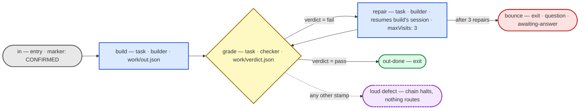

# The engine

The always-awake harness that runs a claimed plan through a configured
node graph of headless agent sessions, graded and repaired until it
passes. Specced in `specs/engine.md`; the mechanics live as plain
Node ESM modules beside this file, tested with `node --test engine/`.

## The current workflow graph

This diagram is generated from the live graph config and tested for
drift: any change that touches the graph must keep this block in sync,
and the drift test fails until it does.

A stamp that matches no declared condition — `verdict: "maybe"` or a
missing field — is a loud defect naming the stamp; it is never routed
anywhere. Out-links are conditional or unconditional, never a mixture,
never a catch-all.

Legend: gray = entry, blue = task, yellow = decision, green/red = the
two exits. The refinement loop is the circle through `grade` and
`repair`; `maxVisits: 3` is the structure's bound — the number is the
config's.

## The config tree

`config.json` is a thin manifest of pointers; every agent, node, and
skill is its own Markdown file with constrained frontmatter:

- `agents/<name>.md` — the fitting (job, model, capabilities,
  permissions) and the skills the agent bears; the body is the role line.
- `nodes/<id>.md` — the node's identity, objective, dispatched agent,
  artifact, limits, and its out-links (links live with the node they
  leave).
- `skills/<id>.md` — a real skill document; the body is the instructions
  the brief carries into the session.

Every config change is gated before it is trusted: `node
engine/verify-config-cli.mjs engine/config.json` names any fault —
load, schema, structure, or a trapped matrix path — and sound means a
later failure is the engine's, not the config's.